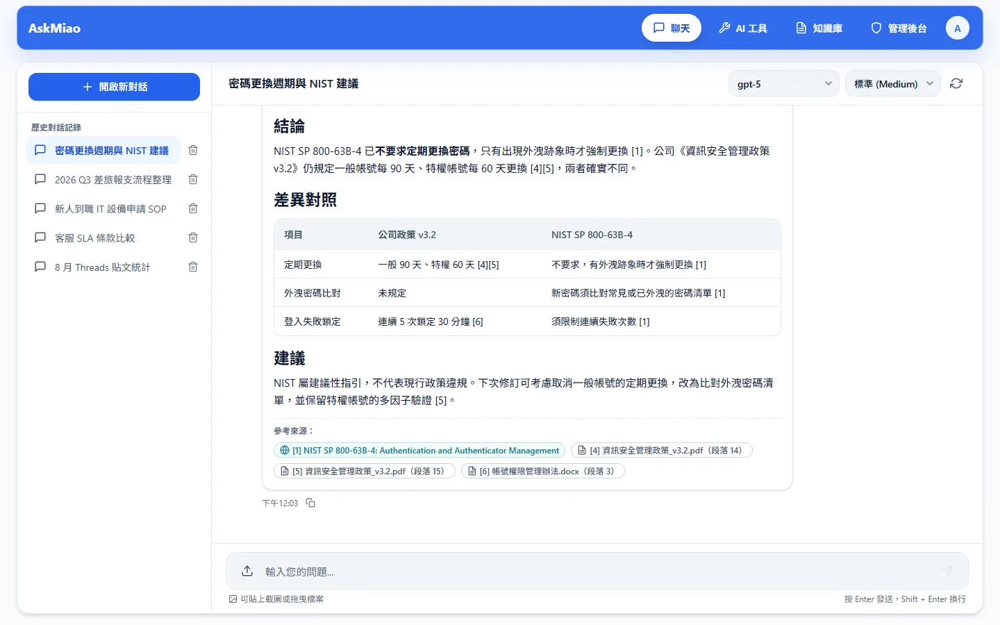
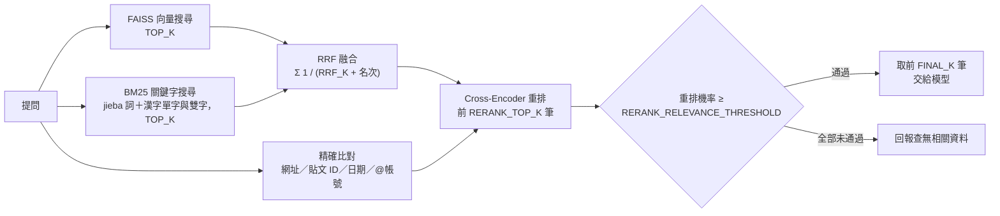
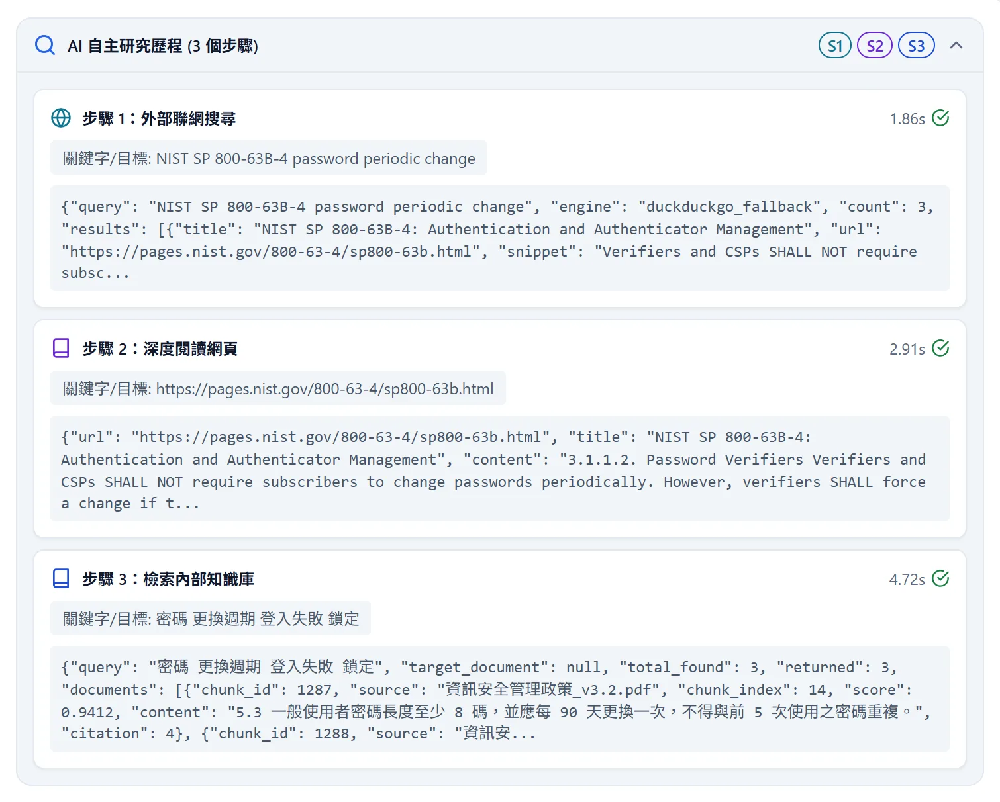
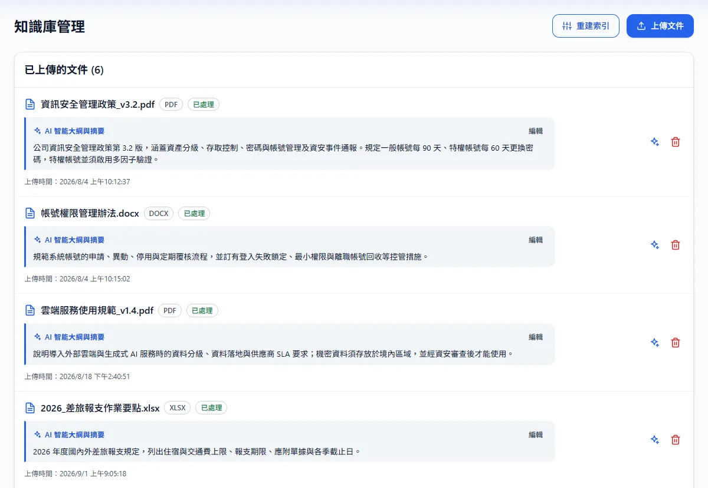
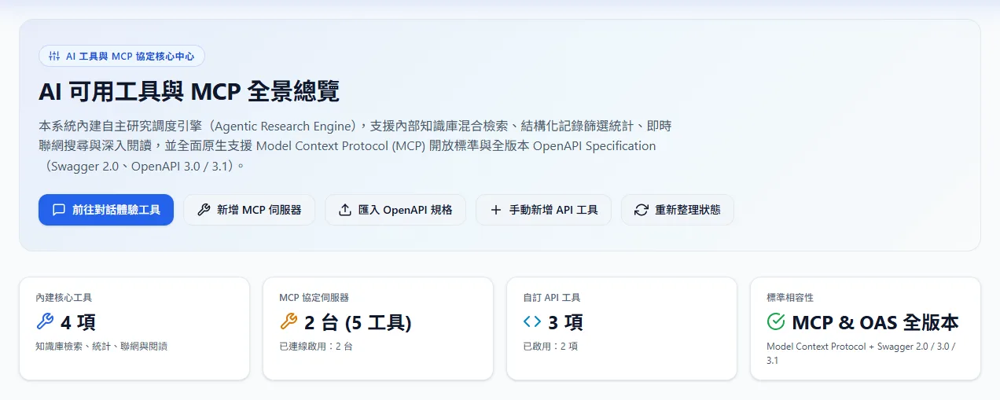
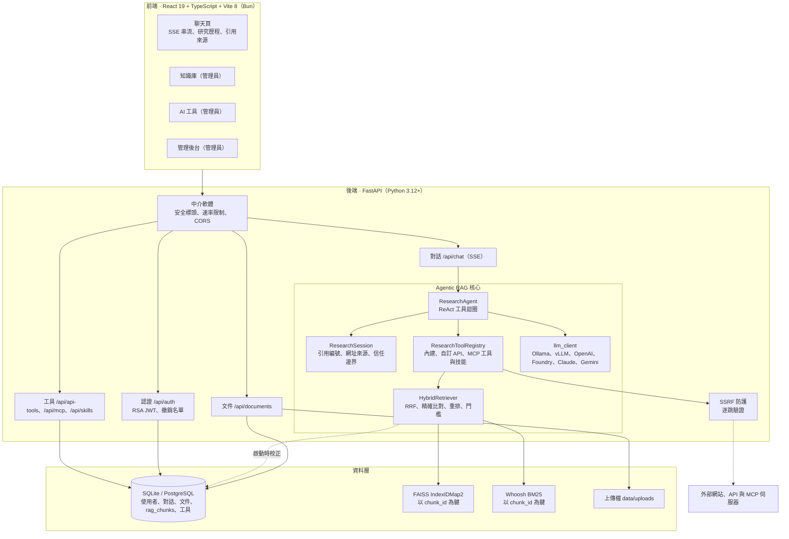
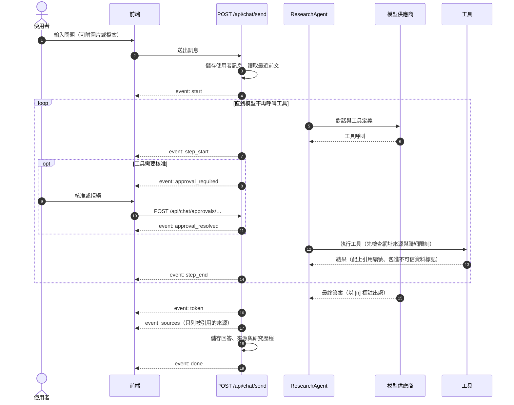

<div align="center">


# AskMiao

**會自己查證、答案附出處的企業知識庫對話系統**

以混合檢索（FAISS + BM25 + Cross-Encoder）與 Agentic RAG 自主研究回答問題，<br>答案中的每個論點都能追溯到文件段落或網頁；知識庫查不到時照實說。

[繁體中文](README.md) | [English](README_en.md)

[](CHANGELOG.md)
[](https://www.python.org/)
[](https://fastapi.tiangolo.com/)
[](https://react.dev/)
[](https://www.typescriptlang.org/)
[](https://vite.dev/)
[](https://bun.sh/)
[](LICENSE)

[介紹網站](https://scorpio-meow.github.io/AskMiao/) · [快速開始](#快速開始) · [文件導覽](#文件導覽) · [版本變更紀錄](CHANGELOG.md) · [升級指南](docs/upgrading.md)

</div>

<br>

<picture>
  <source media="(prefers-color-scheme: dark)" srcset="site/assets/screens/hero-chat-dark.webp">
  
</picture>

> [!TIP]
> 從舊版升級前請先閱讀 [升級指南](docs/upgrading.md)，每個主版本都有需要手動處理的變更；要部署到一台主機給團隊使用，見 [部署指南](docs/deployment.md)。

## 目錄

- [特色一覽](#特色一覽)
- [功能特色](#功能特色)
- [畫面預覽](#畫面預覽)
- [系統架構](#系統架構)
- [快速開始](#快速開始)
- [設定](#設定)
- [專案結構](#專案結構)
- [開發與測試](#開發與測試)
- [疑難排解](#疑難排解)
- [文件導覽](#文件導覽)
- [版本資訊](#版本資訊)
- [貢獻指南](#貢獻指南)
- [授權條款](#授權條款)

---

## 特色一覽

| | 能力 | 說明 |
|---|---|---|
| 1 | **答案可追溯** | 答案以 `[n]` 標註出處，來源標籤只列實際引用的文件段落或網頁，點開即可核對原文 |
| 2 | **查不到就照實說** | 重排機率低於門檻的片段一律濾除，全部未通過時明確回報「知識庫中查無相關資料」，不硬湊答案 |
| 3 | **自主研究** | ReAct Agent 自行決定查知識庫、精確統計記錄、上網搜尋或深入閱讀網頁，研究歷程即時顯示 |
| 4 | **混合檢索** | 向量與 BM25 每次必跑，以 RRF 依名次融合，再由 Cross-Encoder 重排；片段以資料庫 chunk_id 為準 |
| 5 | **六家模型供應商** | Ollama、vLLM、OpenAI、Microsoft Foundry、Anthropic Claude、Google Gemini 都能呼叫工具與串流 |
| 6 | **外部工具與 MCP** | 貼上 OpenAPI 規格即可匯入 API 工具，也能接入 MCP 伺服器（含 OAuth 授權）；只限管理員管理，有副作用的呼叫先經使用者核准 |
| 7 | **Agent Skills** | 直接上傳技能資料夾（可一次安裝整個技能集合）、zip 或 `SKILL.md`，模型依問題自行載入技能的說明與參考檔 |
| 8 | **防護完整** | RSA JWT、Argon2 密碼雜湊與登入失敗節流、逐跳 SSRF 驗證並固定連線 IP、工具憑證加密存放、工具輸出信任邊界、資源上限、對外只回錯誤代碼 |

## 功能特色

### Agentic RAG 自主研究

- **ReAct 研究迴圈**：`ResearchAgent` 以原生工具呼叫（Native Tool Calling）多輪蒐集資料，沒有輪數上限；模型不再呼叫工具時，該次內容就是最終答案。
- **四個內建工具**：

  | 工具 | 用途 |
  |---|---|
  | `search_knowledge_base` | 檢索知識庫片段，可用 `target_document` 限定文件 |
  | `filter_and_count_records` | 依日期、作者、關鍵字精確統計結構化記錄（例如某月的貼文總數） |
  | `web_search` | 聯網搜尋，設定 `OLLAMA_API_KEY` 時優先使用 Ollama Web Search，否則使用 DuckDuckGo |
  | `web_fetch` | 深入閱讀網頁全文，只能讀取使用者訊息或本次工具結果中原樣出現過的網址 |

- **研究歷程**：每一步的工具、參數、結果摘要與耗時以 SSE 即時推送，前端以可摺疊的時間軸呈現。
- **多模態提問**：對話可附圖片與檔案（每則最多 5 個、單檔 15 MiB、合計 20 MiB），圖片以 `image_url` 交給視覺模型，文字類附件抽取內容併入提問。
- **對話檔案**：研究助理可以在對話中建立 Word、Excel、PowerPoint、PDF、Markdown、CSV 等檔案與網頁；修改上傳的文件時另存新版本，原檔不變。檔案在該則回答下方或標題列的「對話檔案」清單中預覽與下載，網頁在隔離的 iframe 中直接執行；研究助理要刪除檔案時先經發問者核准。
- **代理模式**：聊天頁可以切換「查證」與「代理」。代理模式參考 Claude Code、Codex，先列計畫、逐步執行並讀回檔案核對，介面即時顯示計畫清單與完成數；最多呼叫模型 30 輪，用完時回報進度。
- **預覽**：對話檔案與知識庫文件不必下載就能預覽（PDF 逐頁轉圖，Word、Excel、PowerPoint 轉成網頁）；回答引用的網頁先以預覽卡顯示標題、網站與摘要。
- **對話前文**：每次提問從資料庫帶入最近 `CONVERSATION_HISTORY_MESSAGES` 則訊息，後端重啟不會遺失上下文。

### 可追溯的答案

- 每次提問建立一張引用編號表：知識庫片段以 chunk_id、網頁以網址為鍵，第一次出現時配號，模型以 `[n]` 標註出處。
- 來源標籤只列答案實際引用的條目，依第一次引用的順序排列，例如「[2] 員工手冊.pdf（段落 3）」；沒有引用就不顯示來源。
- 工具結果一律包在每次提問 id 不同的 `<untrusted_tool_result>` 標記內，模型只把它當資料看，文件或網頁中夾帶的指令不會被執行。

### 混合檢索引擎



- **兩軌必跑**：只有單一軌道找到的片段也能進入重排候選，專有名詞與代碼查詢不再被淹沒。
- **相關性門檻看重排機率**：精確比對到網址、貼文 ID、日期的片段不受門檻限制，並排在最前面。
- **以資料庫為準**：片段存放在 `rag_chunks` 資料表，FAISS（`IndexIDMap2`）與 BM25 都以 chunk_id 對應；後端啟動時自動校正兩份索引，刪除文件只移除該文件的向量。
- **可量測**：`scripts/evaluate_retrieval.py` 以問答集計算 hit@k、recall@k、MRR 與反例拒絕率，標註原文片段時另計片段層級的 precision@k、nDCG@k 與候選召回，並能一次比較多個門檻；`--corpus` 以內建基準語料在暫存環境比較檢索設定。

### 多供應商 LLM

- 統一呼叫層支援 **Ollama、vLLM、OpenAI、Microsoft Foundry、Anthropic Claude（官方 SDK）、Google Gemini**，依連線的供應商與模型名稱路由，六家都支援工具呼叫與串流。
- 前端可切換模型與六檔推理程度：`無 (None)`、`輕度 (Low)`、`標準 (Medium)`、`深度 (High)`、`極致 (X-High)`、`最大 (Max)`；推理程度會依各供應商的支援範圍對應後傳給模型（OpenAI、Microsoft Foundry、Claude、Gemini、Ollama、vLLM），不支援的檔位在介面上停用。
- 每個帳號在「個人資料」設定自己的 API 連線（位址、金鑰、模型），管理員可建立共用連線並指定哪些帳號能用；`.env` 不設定任何模型商，詳見 [設定參考：API 連線](docs/configuration.md#api-連線)。
- 文件摘要與掃描 PDF 的 OCR 由管理員在「管理後台 → 系統模型」各指定一條共用連線、模型與思考程度，見 [設定參考：系統模型](docs/configuration.md#系統模型)。

### 知識庫與文件處理

- 支援 28 種副檔名：`.txt`、`.md`、`.markdown`、`.pdf`、`.docx`、`.pptx`、`.xlsx`、`.csv`、`.json`、`.jsonl`、`.yaml`、`.yml`、`.xml`、`.html`、`.htm`、`.log`、`.py`、`.js`、`.ts`、`.tsx`、`.jsx`、`.java`、`.cpp`、`.c`、`.sql`、`.sh`、`.ini`、`.env`。
- **PDF 強化擷取**：PyMuPDF 擷取文字，擷取前先替內嵌 TrueType 字型中 ToUnicode 沒有對應（或對到 U+FFFD）的替代字形補上對應：依字型 GSUB 的單一替換反查原本的字元，例如 Illustrator 輸出的 Noto Sans TC 數字，否則會被擷取成「俸」這類字；空白或亂碼頁交給管理員指定的 OCR 系統模型辨識（未指定時不做 OCR），最後以 pypdf 備援。
- **智慧切塊**：JSON、JSONL、YAML、CSV、XLSX 解析成結構化記錄逐筆成為片段（保留巢狀欄位，過長的記錄分段並重複標頭），以「Q：」開頭的 Q&A 文件一問一答成一個片段（超過切塊長度的再切開），其餘依中文標點遞迴切塊。
- **AI 大綱與摘要**：上傳時以管理員指定的摘要系統模型生成文件摘要，可重新生成或手動修訂；未指定系統模型或呼叫失敗時改用規則摘要。摘要也會組成知識庫目錄，幫助 Agent 判斷該查哪份文件。

### 外部工具與 MCP

- **自訂 API 工具**：以表單建立，或匯入 Swagger 2.0、OpenAPI 3.0～3.2 規格（可先套用 Overlay 1.0～1.2，外部 `$ref` 會一併載入）批次建立；Arazzo 1.0／1.1 的工作流程匯入成可串接多個 API 呼叫的工具。參數依 OpenAPI 的 `style`／`explode` 序列化，請求本文依宣告的媒體型別送出，支援 Bearer、API Key（Header / Query / Cookie）、Basic 與 OAuth2 client credentials，可即時測試。呼叫時只接受 `parameters_schema` 宣告的參數，工具網址中固定的查詢參數不能被覆寫。
- **MCP 用戶端**：支援 `stdio` 與 HTTP 傳輸（以 2026-07-28 協定為主，相容只支援交握的舊版伺服器），遠端伺服器可用 OAuth 授權；自動探索工具並以 `mcp_<伺服器>_<工具>` 名稱加入 Agent 工具集；內建時間與檔案系統兩個範本（檔案系統範本只開放專屬沙箱目錄 `backend/mcp_filesystem_sandbox`）。
- **動態載入**：啟用中的工具在每次組裝工具定義時從資料庫載入，變更後不需重啟。
- **呼叫前核准**：有副作用的工具由發問者在對話中核准後才執行，見下方 [工具呼叫核准](#工具呼叫核准)。
- **只限管理員**：工具由所有使用者的 Agent 共用，`/api/api-tools`、`/api/mcp`、`/api/skills` 與「AI 工具」頁只開放管理員（MCP 的 OAuth 回呼與 client metadata 兩個端點除外）；`stdio` 子行程只繼承 `PATH` 等系統變數，拿不到後端的金鑰，在每次新建的空暫存目錄執行，關閉時連同整個子行程樹一起終止（[ADR-0004](docs/adr/0004-tool-admin-permissions-and-subprocess-isolation.md)）。
- **憑證加密存放**：自訂 API 工具的標頭與認證設定、MCP 伺服器的環境變數與標頭以 `TOOL_SECRETS_KEY` 加密後寫入資料庫；管理 API 只回傳 `••••••••`，編輯時保持遮蔽字樣即沿用原值。

### Agent Skills

支援 [Agent Skills](https://agentskills.io/specification) 規格的技能，詳見 [API 參考：Agent Skills](docs/api.md#7-agent-skills-apiskills)。

- **上傳**：「AI 工具 → 上傳技能」可以直接選資料夾、技能目錄的 `.zip`，或只有指示的單一 `SKILL.md`。資料夾中每個含 `SKILL.md` 的目錄各安裝成一個技能，所以能一次裝完 `~/.agents/skills` 這類技能集合；不合規或同名的技能略過並列出原因。
- **漸進載入**：有啟用的技能時，Agent 多出 `activate_skill` 與 `read_skill_resource` 兩個工具。工具說明只列技能名稱與描述，模型啟用技能後才讀到 `SKILL.md` 內文與檔案清單，需要時再逐一讀取參考檔。
- **指定技能**：訊息以 `/技能名稱` 開頭時先載入該技能；在輸入框打 `/` 會列出可用的技能。
- **腳本**：預設不執行。管理員為技能開啟「允許執行腳本」後，Agent 可以用 `run_skill_script` 執行技能內的腳本，每次都要發問者核准（例外見下方 [工具呼叫核准](#工具呼叫核准) 的表格）；腳本以後端的系統帳號執行，**不是沙箱**，只對信任的技能開啟。
- **使用範圍**：每個技能可以開放給所有人，或只給指定的帳號。

### 工具呼叫核准

Agent 可以自己查資料，但不會自己替你送出申請、刪除紀錄或呼叫會寫入的 API。標記為「需要核准」的工具被呼叫時：

1. 串流送出 `approval_required`（含 `approval_id`、工具顯示名稱、實際送出的位置 `target` 與參數），Agent 暫停。
2. 回答中出現確認卡片，列出工具、送出的位置與每一個參數；控制字元與格式字元（例如雙向文字控制、零寬字元）以 `⟦U+…⟧` 標示。
3. 發問者按下「核准執行」或「拒絕」，前端呼叫 `POST /api/chat/approvals/{approval_id}`，串流接著送出 `approval_resolved`。
4. 核准才執行；拒絕或 300 秒未回應時，模型收到「使用者未核准」，並被要求不要再次呼叫同一工具。

| 工具類型 | 預設 | 說明 |
|---|---|---|
| 內建工具（`search_knowledge_base` 等 4 個） | 不需要 | 只讀取資料，由網址來源與 SSRF 規則把關 |
| 自訂 API 工具，方法為 `GET`、`HEAD`、`OPTIONS` | 不需要 | 管理員仍可為個別工具勾選「AI 呼叫前需使用者在對話中確認」 |
| 自訂 API 工具，其他方法 | 需要 | 升級到 4.0.0 時，既有工具依 HTTP 方法自動回填 |
| MCP 伺服器 | 需要 | 以伺服器為單位設定，卡片顯示「伺服器 → 工具」 |
| 技能腳本 `run_skill_script` | 需要 | 技能的 `allowed-tools` 列出 `run_skill_script` 時，該技能的腳本在同一次提問內不再詢問 |
| 刪除對話檔案 `delete_conversation_file` | 一律需要 | 技能的 `allowed-tools` 也不能免除；使用者自己在介面上刪除不需要核准 |

- 待核准項目綁定發問者，其他帳號以同一個 `approval_id` 回覆會得到 `404`。
- 不是由使用者在對話中發起的 Agent 呼叫沒有人能核准，這類工具一律不執行。
- 設計背景與取捨見 [ADR-0006](docs/adr/0006-tool-call-approval.md)；[介紹網站](https://scorpio-meow.github.io/AskMiao/#approval) 有可操作的示範。

### 安全設計

- **認證**：RSA-2048 簽署的 JWT 存取權杖（RSA 金鑰無法載入時拒絕啟動），每次請求都以資料庫中的帳號狀態與權限為準；重新整理權杖存放在 HttpOnly Cookie，只能使用一次；登出時兩者寫入撤銷名單；變更密碼後，該帳號先前簽發的所有權杖立即失效；密碼以 Argon2 雜湊（舊的 bcrypt 雜湊在登入時自動升級）。
- **登入與註冊**：同一登入識別或同一來源位址在時間視窗內失敗達門檻後暫停登入，回傳 `429` 與 `Retry-After`（門檻由 `LOGIN_*` 設定）；`ALLOW_REGISTRATION=false` 時不開放自行註冊，帳號由管理員以 `scripts/create_user.py` 建立。
- **出站請求**：OpenAPI 規格網址、`web_fetch`、自訂 API 工具與 MCP HTTP 傳輸都經 `ssrf_protection.py` 驗證，每一次轉址都重新檢查並把連線固定在驗證過的 IP，阻擋內網、雲端中繼資料端點與危險連接埠；使用者提供的網址與管理員設定的端點各用一個 DNS 執行緒池。
- **工具憑證與參數**：工具憑證以 `TOOL_SECRETS_KEY`（Fernet）加密存放，管理 API 不再讀出；自訂 API 工具只接受 `parameters_schema` 宣告的參數，其他參數回傳 `400`。
- **資源上限**：請求本文、訊息長度、附件數量與大小、聊天附件的解析量、工具結果、同時串流數與附件儲存量都有上限，詳見 [資源上限](docs/configuration.md#資源上限)。
- **錯誤代碼**：未預期例外只對外回傳隨機錯誤代碼，完整堆疊只寫入伺服器日誌（CWE-209 / CWE-497）。
- **日誌遮蔽**：物件遞迴與正規表示式雙層遮罩，密碼、權杖與 Authorization 標頭一律呈現為 `[REDACTED]`。
- **相依套件**：後端 `requirements.txt` 以雜湊鎖定所有套件的版本，安裝時驗證雜湊；前端提交 `bun.lock` 並設定 `frozenLockfile = true`。
- **部署**：compose 的 PostgreSQL 以非超級使用者連線；`HOST`、`RELOAD`、`COOKIE_SECURE` 必須明確設定；互動式 API 文件只在 `ENABLE_API_DOCS=true` 時提供。
- **其他**：安全回應標頭、依來源 IP 的速率限制（預設不採信 `X-Forwarded-For`，信任的反向代理以 `FORWARDED_ALLOW_IPS` 指定）、CORS 白名單、檔名與路徑遍歷檢查、前端反點擊劫持與建置時寫入 `index.html` 的 CSP。

#### 防護對照

| 威脅 | 防護 | 位置 |
|---|---|---|
| 文件或網頁夾帶提示注入 | 工具結果包在每次提問 id 不同的 `<untrusted_tool_result>` 標記內；`web_fetch` 只能讀使用者訊息或本次工具結果中出現過的完整網址 | `rag/research_session.py` |
| SSRF 與 DNS rebinding | 協定、連接埠、主機名稱、IP 與 DNS 結果逐跳驗證，連線固定在核可的 IP | `core/ssrf_protection.py` |
| Agent 擅自改動外部系統 | 有副作用的工具呼叫前由發問者核准 | `rag/tool_approval.py` |
| 工具設定被濫用 | 工具管理只限管理員；`stdio` 子行程不繼承後端金鑰，在空的暫存目錄執行 | `api/api_tools.py`、`api/mcp.py`、`services/mcp_service.py` |
| 模型夾帶工具沒有開放的參數 | 自訂 API 工具只接受 `parameters_schema` 宣告的參數；工具網址中固定的查詢參數不可覆寫 | `api/api_tools.py` |
| 資料庫或備份外流時洩漏工具憑證 | 自訂 API 工具的標頭與認證設定、MCP 伺服器的環境變數與標頭以 `TOOL_SECRETS_KEY` 加密存放，管理 API 只回傳遮蔽字樣 | `core/tool_secrets.py` |
| 帳號停用後權杖仍有效 | 每次請求依 `sub` 讀取帳號狀態與角色，重新整理權杖只能使用一次 | `core/jwt_auth.py`、`api/auth.py` |
| 權杖外洩後持續換發 | 變更密碼時更新 `users.tokens_valid_after`，先前簽發的存取與重新整理權杖一律無效 | `core/jwt_auth.py`、`crud/crud_user.py` |
| 密碼猜測 | 依登入識別與來源位址分別計數，達門檻後暫停登入並回傳 `429` | `core/login_throttle.py` |
| 任何人都能註冊並使用知識庫與工具 | `ALLOW_REGISTRATION=false` 時註冊回傳 `403`，帳號由管理員建立 | `api/auth.py`、`backend/scripts/create_user.py` |
| 資源耗盡 | 請求本文、附件與附件解析量、工具結果、串流數與密碼雜湊數都有上限 | `core/limits.py`、`core/body_limit.py` |
| 內部資訊外洩 | 對外只回錯誤代碼，日誌雙層遮蔽並限制欄位長度 | `core/error_response.py`、`core/security_logging.py` |
| SQL 注入進一步執行系統指令 | compose 的 PostgreSQL 以非超級使用者連線，不能以 `COPY ... TO PROGRAM` 執行指令或讀取伺服器檔案 | `backend/init-app-role.sh` |
| 注入的 HTML 執行腳本 | 建置時把 CSP 寫入 `index.html`，只允許建置產物與內嵌腳本雜湊 | `frontend/vite.config.js` |
| 安裝到被竄改或未經審查的套件版本 | 後端依雜湊安裝 `requirements.txt`，前端依凍結的 `bun.lock` 安裝 | `backend/requirements.in`、`frontend/bun.lock` |

#### 主要資源上限

| 項目 | 上限 | 超過時 |
|---|---|---|
| 一般請求本文 | 1 MiB（帶有效權杖的聊天送出，以及權杖帶有 `is_admin` 的文件與技能上傳另計） | `413` |
| 單則聊天訊息 | 20,000 字 | `422` |
| 每則訊息的附件 | 5 個，單檔 15 MiB、合計 20 MiB | `422` |
| 聊天附件的解析量 | docx／pptx 建成 DOM 的 XML 合計 8 MiB，解壓合計 64 MiB，成員 10,000 個 | 不讀取該附件，並告知模型 |
| 同時解析的聊天附件 | 每個後端行程 2 個 | 排隊等候 |
| 每位使用者的附件與對話檔案儲存量 | 200 MiB | `413`，研究助理無法再建立檔案 |
| 每個對話的檔案 | 100 個，單檔 15 MiB | 無法再存檔 |
| 每位使用者同時進行的回答串流 | 2 個 | `429` |
| 單次工具結果放進模型 | 20,000 字 | 截斷 |
| 待核准的工具呼叫 | 300 秒 | 視為拒絕 |
| 登入失敗 | 同一登入識別 `LOGIN_MAX_FAILURES_PER_ACCOUNT` 次、同一來源位址 `LOGIN_MAX_FAILURES_PER_ADDRESS` 次（`LOGIN_FAILURE_WINDOW_SECONDS` 秒內） | `429`，暫停登入 `LOGIN_LOCKOUT_SECONDS` 秒 |

完整清單見 [資源上限](docs/configuration.md#資源上限)。

### 前端體驗

- 串流中可停止回答、失敗可重新傳送；注音與倉頡等輸入法按 Enter 選字不會誤送。
- 淺色、深色與跟隨系統三種外觀，第一次繪製前套用，不會閃白。
- 鍵盤與螢幕報讀軟體可完整操作，文字對比達 WCAG AA；手機版面單列頂欄、聊天頁固定一個視窗高度。
- 刪除前一律確認，網路離線與恢復時提示，非管理員進入管理頁時顯示「沒有權限」頁面。
- 回答中的 Markdown 圖片顯示為點擊後才在新分頁開啟的連結，不會自動向外部主機載入；外部連結在新分頁開啟並標示實際主機。

## 畫面預覽

<table>
  <tr>
    <td width="33%" valign="top">
      <picture>
        <source media="(prefers-color-scheme: dark)" srcset="site/assets/screens/feature-trace-dark.webp">
        
      </picture>
      <p align="center"><b>研究歷程</b><br>每一步的工具、參數與結果</p>
    </td>
    <td width="33%" valign="top">
      <picture>
        <source media="(prefers-color-scheme: dark)" srcset="site/assets/screens/feature-docs-dark.webp">
        
      </picture>
      <p align="center"><b>知識庫管理</b><br>上傳、AI 摘要與重建索引</p>
    </td>
    <td width="33%" valign="top">
      <picture>
        <source media="(prefers-color-scheme: dark)" srcset="site/assets/screens/feature-tools-dark.webp">
        
      </picture>
      <p align="center"><b>AI 工具</b><br>OpenAPI 匯入與 MCP 伺服器</p>
    </td>
  </tr>
</table>

> 截圖以真實前端搭配示範資料擷取，畫面中的文件、對話與數字都只供示範。

## 系統架構



一次提問的完整旅程：



各模組的設計細節見 [系統架構與設計](docs/architecture.md)。

## 快速開始

### 環境需求

| 項目 | 需求 | 說明 |
|---|---|---|
| Python | 3.12 以上 | 後端 |
| Bun | 1.x | 前端套件管理、開發伺服器與建置 |
| 資料庫 | SQLite（Python 內建）或 PostgreSQL | 預設可零依賴使用 SQLite |
| 模型 | 首次啟動下載約 1.2 GB | 嵌入模型 `BAAI/bge-small-zh-v1.5` 與重排模型 `BAAI/bge-reranker-base` |
| LLM | 擇一 | 本機的 Ollama 或 vLLM，或 OpenAI、Microsoft Foundry、Anthropic、Gemini 的 API 金鑰 |

### 1. 取得原始碼

```bash
git clone https://github.com/Scorpio-meow/AskMiao.git
cd AskMiao
```

### 2. 設定並啟動後端

```bash
cd backend

# 建立並啟用虛擬環境（Windows 可用 py -m venv .venv）
python -m venv .venv
# Windows PowerShell
.\.venv\Scripts\Activate.ps1
# Linux / macOS
source .venv/bin/activate

# requirements.txt 鎖定所有套件的版本與雜湊，安裝時逐一驗證
pip install -r requirements.txt
cp .env.example .env
```

啟動前先編輯 `backend/.env`：

1. **資料庫**：範本的 `DATABASE_URL` 指向 PostgreSQL；零依賴啟動請改為 `DATABASE_URL=sqlite:///./chatbot.db`。
2. **金鑰**：`TOOL_SECRETS_KEY` 要換成每個部署自行產生的 Fernet 金鑰（範本值不是有效的金鑰，沒換掉時後端拒絕啟動）：

   ```bash
   python -c "from cryptography.fernet import Fernet; print(Fernet.generate_key().decode())"
   ```

   JWT 一律以 `backend/keys/` 的 RSA 金鑰簽署，不需要另設簽署金鑰。
3. **模型**：`.env` 不需要設定模型商。模型的位址與金鑰在後端啟動後到介面上設定成 API 連線，見步驟 5。

其餘必填設定範本都已提供，在本機開發時可保持範本值：`HOST=127.0.0.1` 只接受本機連線、`RELOAD=false`、`COOKIE_SECURE=false`（以 HTTPS 提供服務時必須改為 `true`）、`ENABLE_API_DOCS=false`、`ALLOW_REGISTRATION=false`（第一位管理員見步驟 4），以及登入失敗節流的四個門檻，各項說明見 [設定](#設定)。接著啟動後端：

```bash
python main.py
```

首次啟動會自動建立資料表、產生 JWT 用的 RSA 金鑰（`backend/keys/`，後端帳號需能寫入；金鑰無法載入時後端拒絕啟動），並下載嵌入與重排模型。啟動完成後：

- API：`http://localhost:8001`
- 互動式 API 文件（Swagger UI）：`http://localhost:8001/docs`，只在 `ENABLE_API_DOCS=true` 時提供（範本為 `false`，對外服務時請保持關閉）

> [!NOTE]
> `init_db.py` 是替舊版 PostgreSQL 資料庫補欄位與索引的相容腳本，全新安裝不需要執行；SQLite 也不支援其中的 `ADD COLUMN IF NOT EXISTS` 語法。

### 3. 啟動前端

開啟另一個終端機：

```bash
cd frontend
bun install
bun run dev
```

`bun install` 只依版本庫中的 `bun.lock` 安裝（`frontend/bunfig.toml` 設定 `frozenLockfile = true`），`bun.lock` 與 `package.json` 不一致時直接失敗。

以瀏覽器開啟 `http://localhost:3000`。沒有 `frontend/.env` 時，前端呼叫相對路徑 `/api`，由 Vite 開發伺服器代理到 `http://127.0.0.1:8001`，不需要設定 CORS。若複製了 `frontend/.env.example`（`PORT=3001`、直接呼叫後端），改開 `http://localhost:3001`。

> [!NOTE]
> Vite 開發與預覽伺服器只監聽 `localhost`，區網內的其他裝置連不上。需要讓其他裝置使用時，請以 `bun run build` 建置，再由正式的網頁伺服器提供 `frontend/build/` 並反向代理 `/api`。

### 4. 建立第一位管理員

「知識庫」、「AI 工具」與「管理後台」只限管理員，而系統不會預先建立管理員帳號。範本的 `ALLOW_REGISTRATION=false` 不開放自行註冊（登入頁不顯示註冊入口，`POST /api/auth/register` 回傳 `403`），帳號由管理員以 `scripts/create_user.py` 建立：

1. 在 `backend/`（已啟用虛擬環境）執行下列指令，依提示輸入兩次密碼。使用者名稱 3 至 50 字，只能包含中文、英文字母、數字、底線與連字號；密碼至少 8 個字元，需包含大寫字母、小寫字母與數字。

   ```bash
   python scripts/create_user.py --username admin --email admin@example.com --admin
   ```

2. 在前端以這組帳號登入，導覽列就會出現管理功能。其他帳號同樣以這個腳本建立（不加 `--admin` 即為一般使用者），也可以在「管理後台」把既有使用者設為管理員。

密碼以互動方式輸入，不會留在殼層歷史與行程清單中。腳本套用與註冊相同的規則，並透過後端的設定與資料庫連線執行，SQLite 與 PostgreSQL 都適用；請在 `backend/` 執行，`sqlite:///./chatbot.db` 這類相對路徑才會指向後端使用的資料庫。

`ALLOW_REGISTRATION=true` 時，也可以先在前端「註冊」頁建立帳號，再在 `backend/` 執行下列指令把它設為管理員（把 `your_username` 換成剛註冊的使用者名稱），登出後重新登入：

```bash
python -c "from sqlalchemy import text; from app.models.database import engine; conn = engine.connect(); conn.execute(text('UPDATE users SET is_admin = :flag WHERE username = :name'), {'flag': True, 'name': 'your_username'}); conn.commit()"
```

### 5. 上傳文件並開始提問

1. 以管理員進入「管理後台 → 共用 API 連線」建立連線並指定可使用的帳號（各帳號也可以在「個人資料 → 我的 API 連線」自行建立）。要讓上傳時用模型產生摘要、辨識掃描 PDF，再到「管理後台 → 系統模型」各指定一個模型。
2. 進入「知識庫」，上傳文件（單次最多 10 個檔案，單檔上限由 `MAX_FILE_SIZE_MB` 決定）。系統會擷取文字、生成摘要並建立索引。
3. 回到「聊天」，選擇連線的模型與推理程度後提問。答案中的 `[n]` 可對應下方的來源標籤。

### 使用 PostgreSQL（選用）

`backend/docker-compose.yml` 提供 PostgreSQL 17。資料庫的 volume 第一次初始化時依序執行 `init.sql`（建立資料表）與 `init-app-role.sh`（建立後端連線用的非超級使用者，並把資料表交給它擁有）。先在 `backend/.env` 設定下列三項（缺少任一項時 compose 拒絕啟動），兩組密碼請用不同的隨機字串，並讓 `DATABASE_URL` 使用應用程式帳號：

```dotenv
POSTGRES_PASSWORD=<超級使用者 postgres 的密碼>
POSTGRES_APP_USER=askmiao_app
POSTGRES_APP_PASSWORD=<應用程式帳號的密碼>
DATABASE_URL=postgresql+psycopg2://askmiao_app:<應用程式帳號的密碼>@localhost:7690/chatbot
```

接著啟動容器：

```bash
cd backend
docker compose up -d
```

容器只在本機回送位址 `127.0.0.1:7690` 開放，區網與公網都連不到。`POSTGRES_PASSWORD` 只供 compose 與資料庫管理使用，後端不讀取；後端以非超級使用者連線，即使出現 SQL 注入也無法執行系統指令或讀取伺服器檔案。密碼含 `@`、`:`、`/` 等字元時，`DATABASE_URL` 中需改寫成百分比編碼。

以舊版 compose 初始化的 volume 不會自動建立應用程式帳號：設定上述變數並以 `docker compose up -d --wait` 重建容器、等它就緒後，執行一次 `docker compose exec postgres bash /docker-entrypoint-initdb.d/20-app-role.sh`，詳見 [升級指南](docs/upgrading.md#從-400-升級到-500)。

### 以 Docker Compose 部署

要部署到一台主機（例如 VM）給團隊使用時，`deploy/` 提供 PostgreSQL、後端與 nginx 三個容器的 Docker Compose 設定，步驟見 **[部署指南](docs/deployment.md)**。

## 設定

後端設定集中在 `backend/.env`，範本 `backend/.env.example` 已提供建議值（`TOOL_SECRETS_KEY` 須自行產生）。下列 20 項沒有預設值，缺少任一項後端就無法啟動，各項的範本值與作用見 [設定參考：必填設定](docs/configuration.md#必填設定)：

- **資料庫與路徑**：`DATABASE_URL`、`LOG_DIR`、`SKILLS_DIR`、`DOMAIN_PROFILE_PATH`
- **帳號與安全**：`TOOL_SECRETS_KEY`、`ALLOW_REGISTRATION`、`LOGIN_MAX_FAILURES_PER_ACCOUNT`、`LOGIN_MAX_FAILURES_PER_ADDRESS`、`LOGIN_FAILURE_WINDOW_SECONDS`、`LOGIN_LOCKOUT_SECONDS`、`COOKIE_SECURE`、`ENABLE_API_DOCS`
- **伺服器**：`HOST`、`RELOAD`
- **Agent 與檢索**：`ENABLE_WEB_SEARCH`、`CONVERSATION_HISTORY_MESSAGES`、`WEB_FETCH_ALLOWED_DOMAINS`、`BLOCK_WEB_TOOLS_AFTER_KB`、`RRF_K`、`RERANK_RELEVANCE_THRESHOLD`

常用的選填設定：

| 變數 | 說明 |
|---|---|
| `LLM_TIMEOUT`、`OLLAMA_TEMPERATURE`、`OLLAMA_NUM_PREDICT`、`OLLAMA_NUM_CTX` | LLM 呼叫逾時，以及套用到所有 Ollama 連線的生成參數 |
| `CHUNK_SIZE`、`CHUNK_OVERLAP` | 切塊長度與重疊（範本 300 / 100） |
| `HF_HOME`、`HF_HUB_OFFLINE` | 模型快取位置與離線模式 |
| `ALLOWED_ORIGINS` | CORS 允許來源（前端直接呼叫後端時需要） |
| `FORWARDED_ALLOW_IPS` | 會覆寫 `X-Forwarded-For` 的反向代理位址；未設定時速率限制與依位址的登入節流都以實際連線對端計算 |

所有設定（含預設值、範本值、供應商路由規則、資源上限與前端環境變數）請見 **[設定參考](docs/configuration.md)**。

## 專案結構

```text
AskMiao/
├── backend/                          # FastAPI 後端
│   ├── main.py                       # 進入點（python main.py）
│   ├── app/
│   │   ├── __init__.py               # 後端版本號 __version__
│   │   ├── api/                      # 路由：auth、chat、documents、api_tools、mcp、skills、llm_connections、admin
│   │   ├── core/                     # 設定、認證、安全與 LLM 呼叫層
│   │   │   ├── config.py             # Settings：所有環境變數與驗證規則
│   │   │   ├── lifespan.py           # 啟動流程：建表、初始化 RAG、上傳檔監看
│   │   │   ├── llm_client.py         # 六家供應商的統一呼叫層（工具呼叫、串流）
│   │   │   ├── jwt_auth.py           # RSA JWT、Argon2 密碼雜湊、撤銷名單檢查
│   │   │   ├── login_throttle.py     # 登入失敗節流（依登入識別與來源位址）
│   │   │   ├── tool_secrets.py       # 工具憑證加密與管理 API 遮蔽
│   │   │   ├── limits.py             # 資源上限常數（請求本文、附件、工具結果、日誌等）
│   │   │   ├── body_limit.py         # 請求本文大小上限中介層
│   │   │   ├── ssrf_protection.py    # 出站網址驗證、逐跳 SSRF 檢查與連線 IP 固定
│   │   │   ├── error_response.py     # 對外錯誤代碼
│   │   │   ├── security_logging.py   # 日誌雙層遮蔽
│   │   │   └── domain_profile.py     # 領域設定檔載入與驗證
│   │   ├── models/                   # SQLAlchemy 資料表與 Pydantic 請求模型
│   │   ├── rag/                      # 檢索與 Agentic RAG 核心
│   │   │   ├── contextual_rag.py     # HybridContextualRAG：索引校正、寫入與檢索的門面
│   │   │   ├── agent.py              # ResearchAgent：ReAct 工具迴圈與串流事件
│   │   │   ├── research_session.py   # 單次提問的引用編號、網址來源限制與不可信資料包裝
│   │   │   ├── tools.py              # 內建工具與自訂 API / MCP 工具的註冊與執行
│   │   │   ├── tool_approval.py      # 有副作用工具的對話內核准
│   │   │   ├── pipeline.py           # 切塊與 Agent 串流管線
│   │   │   ├── tokenizers.py         # jieba 斷詞與斷詞簽章
│   │   │   ├── evaluator.py          # 檢索評估（hit@k、MRR、反例拒絕率）
│   │   │   ├── indices/              # chunk_store（rag_chunks）、vector_store（FAISS）、bm25_store
│   │   │   └── retrievers/hybrid.py  # RRF 融合、精確比對、重排與相關性門檻
│   │   ├── services/                 # 對話、文件處理（含 PDF OCR）、OpenAPI 與 Arazzo、MCP 用戶端與 OAuth、Agent Skills、API 連線與系統模型
│   │   └── tasks/uploads_watcher.py  # 上傳檔遺失監看（只記警告）
│   ├── config/domain_profile.json    # 領域設定檔
│   ├── eval/                         # 檢索評估問答集與內建基準語料（corpus/）
│   ├── scripts/                      # 維運腳本（含建立帳號的 create_user.py）
│   ├── tests/                        # pytest 測試
│   ├── docker-compose.yml            # 選用的 PostgreSQL 17（本機 127.0.0.1:7690，需設 POSTGRES_PASSWORD 與 POSTGRES_APP_*）
│   ├── init.sql                      # PostgreSQL 初始化結構
│   ├── init-app-role.sh              # PostgreSQL 後端連線帳號（非超級使用者）
│   ├── init_db.py                    # 舊版 PostgreSQL 資料庫的相容補丁
│   ├── requirements.in               # 直接依賴；新增或升級套件時修改這個檔案
│   ├── requirements.txt              # 由 requirements.in 產生，鎖定版本與雜湊
│   └── .env.example                  # 後端設定範本
├── frontend/                         # React 19 + TypeScript + Vite 8
│   ├── src/
│   │   ├── pages/                    # Chat/、AiTools/、Admin/、Documents、AdminDashboard、登入、註冊、個人資料
│   │   ├── components/               # Layout、路由守衛、LlmConnections/ 與 ui/ 元件庫
│   │   ├── hooks/                    # useChat（串流、停止與重送）、useAuth、useDocuments、useLlmProviders 等
│   │   ├── services/                 # api.ts（Axios 與權杖更新）、sse.ts（SSE 解析器）
│   │   ├── contexts/ThemeContext.tsx # 淺色／深色／跟隨系統
│   │   └── styles/                   # 設計 token 與 reset
│   ├── package.json                  # 前端版本號與指令
│   ├── bun.lock                      # 鎖定的前端相依套件（bun install 不會改寫）
│   └── .env.example
├── deploy/                           # Docker Compose 部署：PostgreSQL、後端、nginx 前端與 gen-env.sh
├── site/                             # GitHub Pages 介紹頁（純靜態）
├── docs/
│   ├── api.md                        # API 參考
│   ├── architecture.md               # 系統架構與設計
│   ├── configuration.md              # 設定參考
│   ├── deployment.md                 # 部署指南（Docker Compose）
│   ├── troubleshooting.md            # 疑難排解
│   ├── upgrading.md                  # 升級指南
│   └── adr/                          # 架構決策紀錄
├── .github/workflows/deploy-pages.yml # site/ 有變更時部署到 GitHub Pages
├── llms.txt                          # 給 AI Agent 的專案導覽
├── CHANGELOG.md                      # 版本變更紀錄
└── LICENSE
```

每份文件都有 `_en` 結尾的英文版。

## 開發與測試

### 後端測試

```bash
cd backend
python -m pytest
```

- 測試會載入設定，必填設定須放在 `backend/.env` 或環境變數中。
- 測試直接使用設定的 `DATABASE_URL`，並會清空 `agent_skills` 等資料表。請以環境變數讓它指向拋棄式的 SQLite（例如 `DATABASE_URL=sqlite:///./test-run.db`），不要對開發或正式資料庫執行。
- 部分測試會載入實際的嵌入與重排模型（需要模型快取），完整執行約需數分鐘。
- Windows 使用者名稱含中文等非 ASCII 字元時，請加上 `--basetemp=C:\pytest-tmp` 之類的 ASCII 路徑，否則 FAISS 寫入暫存索引會失敗。

### 前端檢查

```bash
cd frontend
bun run test --run   # Vitest 單元測試
bun run lint         # ESLint（JS / JSX）
bun x tsc --noEmit   # TypeScript 型別檢查
bun run build        # 產出 build/
```

`bun run build` 會把 CSP 以 `<meta>` 寫入 `build/index.html`：腳本只允許建置產物與 `index.html` 內嵌腳本的雜湊，`connect-src` 依 `VITE_API_BASE`／`VITE_API_URL` 加入 API 來源，因此變更這兩個設定後需要重新建置。開發伺服器不套用這份 CSP。

### 相依套件

- **後端**：`requirements.in` 只列直接依賴；`requirements.txt` 由它產生，鎖定每個套件（含間接依賴）的版本與雜湊，`pip install -r requirements.txt` 會逐一驗證。新增或升級套件時修改 `requirements.in`，在 `backend/` 以 uv 重新產生 `requirements.txt`，兩個檔案一起提交：

  ```bash
  uv pip compile requirements.in --universal --python-version 3.12 --generate-hashes -o requirements.txt
  ```

- **前端**：`bun.lock` 隨版本庫提交，`frontend/bunfig.toml` 設定 `frozenLockfile = true`：`bun install` 只依 `bun.lock` 安裝，與 `package.json` 不一致時直接失敗，`bun add` 也無法改寫 `bun.lock`。新增或升級套件時，暫時把 `frozenLockfile` 改為 `false` 更新 `bun.lock`，再改回 `true`，並把 `package.json` 與 `bun.lock` 一起提交。

### 維運腳本

在 `backend/` 以 `python scripts/<腳本>` 執行：

| 腳本 | 用途 |
|---|---|
| `create_user.py` | 建立帳號（含第一位管理員）：`--username`、`--email` 必填，`--admin` 建立管理員，密碼以互動方式輸入；見 [建立第一位管理員](#4-建立第一位管理員) |
| `evaluate_retrieval.py` | 以問答集評估檢索品質並比較相關性門檻（唯讀，可與後端同時執行；`--corpus` 改在暫存環境以指定文件建立知識庫），見 [校準相關性門檻](docs/configuration.md#校準相關性門檻) |
| `reprocess_existing_docs.py` | 離線執行與「重建索引」相同的重建：重新擷取文字、替沒有摘要的文件生成摘要（既有摘要保留）、切塊並寫入索引。請先停止後端 |
| `reset_faiss.py` | 刪除 `FAISS_INDEX_PATH`、`METADATA_PATH` 與 `BM25_INDEX_DIR` 指向的索引檔，再依 `rag_chunks` 重新計算（會先詢問確認） |
| `docx_to_txt.py` | 把上傳目錄中的 `.docx` 轉成 `.txt` |

## 疑難排解

後端啟動失敗、登入被暫停、前端連不上後端、每題都查無資料、工具一直要求核准等常見狀況與處理方式，整理在 **[疑難排解](docs/troubleshooting.md)**。以 Docker Compose 部署時的問題見 [部署指南](docs/deployment.md)。

## 文件導覽

| 文件 | 內容 |
|---|---|
| [API 參考](docs/api.md) | 所有端點的權限、請求與回應格式、SSE 事件規格與錯誤代碼 |
| [系統架構與設計](docs/architecture.md) | 分層架構、資料模型、檢索管線、Agent 迴圈、認證與安全設計 |
| [設定參考](docs/configuration.md) | 每個環境變數的預設值與作用、供應商路由、門檻校準、前端設定 |
| [部署指南](docs/deployment.md) | 以 Docker Compose 部署到主機、HTTPS、備份與更新 |
| [疑難排解](docs/troubleshooting.md) | 啟動、登入、前端與工具的常見錯誤與處理方式 |
| [升級指南](docs/upgrading.md) | 從 2.x 升級到 3.0.0，以及之後各版（到 8.6.0 升級到 8.7.0）的步驟、回退方式與常見問題 |
| [架構決策紀錄（ADR）](docs/adr/README.md) | 重大設計的背景、取捨與後續修訂 |
| [llms.txt](llms.txt) | 給 AI Agent 讀的檔案地圖、系統約束與驗證方式 |
| [版本變更紀錄](CHANGELOG.md) | 每個版本的新增、變更、移除與修正 |
| [介紹網站](https://scorpio-meow.github.io/AskMiao/) | 以互動示範說明引用、檢索門檻、工具呼叫核准與出站防護 |

## 版本資訊

- **目前版本**：8.7.0（2026-11-09），變更內容見 [CHANGELOG](CHANGELOG.md)。
- **版本規則**：遵循 [語意化版本](https://semver.org/lang/zh-TW/)。不相容的變更（例如新增必填設定、改變 API 權限或索引格式）升主版號。
- **版本號位置**：後端 `backend/app/__init__.py` 的 `__version__`（OpenAPI 文件與 MCP 交握都引用它）、前端 `frontend/package.json`，發行時與 `CHANGELOG.md` 一併更新。

## 貢獻指南

歡迎透過 Issue 與 Pull Request 參與改進。分支與 Commit 訊息、測試、相依套件、文件雙語與介紹頁同步的規則見 [貢獻指南](.github/CONTRIBUTING.md)，參與前請先閱讀 [行為準則](.github/CODE_OF_CONDUCT.md)。

- **回報問題**：錯誤、功能建議、文件問題與無障礙問題各有 [Issue 範本](https://github.com/Scorpio-meow/AskMiao/issues/new/choose)。
- **安全漏洞**：請依 [安全政策](.github/SECURITY.md) 私下通報，不要開公開的 Issue。
- **無障礙**：目前的做法、支援環境與已知限制見 [無障礙聲明](.github/ACCESSIBILITY.md)。

## 授權條款

本專案以 [MIT 授權條款](LICENSE) 發行。